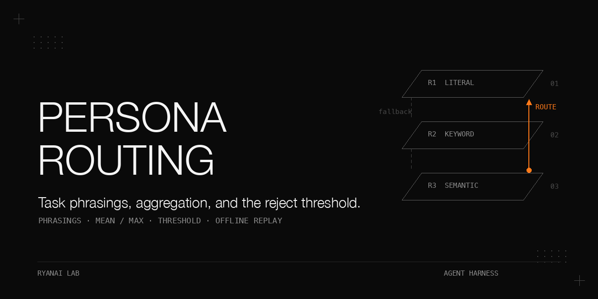

# Routing a task to one of 395 agent personas with no LLM on the hot path

A local embedding router improved only when task phrasings, aggregation, and the reject threshold moved together.
Adding 1,915 short phrasings, changing mean to max, and raising the threshold from 0.68 to 0.72 took exact routing from 11 to 14 of 27 requests while garbage rejection rose from 9 to 10 of 10.
The other settings exposed why those changes are coupled: mean diluted useful rows, max admitted more nonsense, and a higher threshold alone discarded correct routes.
These are historical, deterministic comparisons on a small evaluation bank, selected on that same bank; they are not estimates of future traffic.

## Why this matters

A wrong route is a successful request with the wrong specialist attached.
The chosen persona becomes a sub-agent's system prompt, silently changing its role for the whole task.
Wrong semantic routes scored 0.766 to 0.840 in the recorded analysis, comfortably above the shipped threshold.
An embedding threshold can reject some irrelevant content without distinguishing the right specialist from a confident wrong one.

The operational failures were just as consequential as the scoring failures.
A replaced embedding model disabled the semantic tier for 19 days while health checks stayed green.
Later, a service that remained alive could not survive a cold restart because its index-building path crashed the embedding runner.
This book follows the measurement, the failure paths, and the release contract together.

## What is in this book

1. [The router and its contract](docs/router-contract.md): tier order, row construction, scoring, abstention, and the caller.
2. [Measuring with 37 blind items](docs/blind-evaluation.md): outcome classes, accept sets, uncertainty, and a disputed label.
3. [The 19-day silent outage](docs/silent-outage.md): mutable model tags, cosine collapse, and orphan processes.
4. [The keyword tier](docs/keyword-tier.md): unscored decisions and three rejected repairs.
5. [The utterance sidecar](docs/utterance-sidecar.md): generation, filtering, cached embeddings, and two crash observations.
6. [Mean versus max](docs/aggregation.md): the complete factorial comparison and score distributions.
7. [Calibration](docs/calibration.md): the selection rule, the helper that missed it, and the thin margin.
8. [Shipping](docs/shipping.md): coupled activation, gate baselines, restart identity, and consumer checks.
9. [Failure cases](docs/failure-cases.md): paired gains, known regressions, and confident residual errors.
10. [Pool updates](docs/pool-updates.md): upstream drift and a partly validated shadow-and-apply design.

[Complete historical tables](docs/results.md) retain every table from the source record.
[Expanded pitfalls](docs/pitfalls.md) collect the symptom, cause, and repair chains.
The public code uses original synthetic fixtures; it does not contain the private evaluation prompts, upstream persona texts, derived phrasings, or recorded vector cache.

## The setting

Conditions: historical deployment; timings are indicative for the stated machine class, without a controlled latency distribution.

| Component | Recorded setting |
|---|---|
| Router and embedding host | One Apple-silicon Mac running macOS; user-level launchd service bound to localhost |
| Python | 3.11.15, isolated uv-managed environment; system Python 3.14 resolved `semantic-router` to 0.0.20 without the Ollama encoder |
| Routing library | `semantic-router==0.1.15` (MIT); explicit global `top_k=10` |
| Other pins | `ollama==0.6.2`, `httpx==0.28.1`, `numpy==2.4.6`, `pydantic==2.13.4` |
| Embedding | Qwen3-Embedding 0.6B, 1024 dimensions; stock digest prefix `4c1a55ec`, 0.60 GB |
| Restart-crash server | Ollama 0.30.10, observed 2026-09-23 |
| Evaluated pool | 395 personas from a 2026-05-23 snapshot; 184 English identifiers, 211 Chinese-language identifiers; 78 expanded descriptions |
| Embedded rows | 868 structural rows; 2,783 with the sidecar; exactly +1,915 phrasings; 2,819 unique texts including evaluation leads |
| Evaluation bank | 27 in-domain requests and 10 garbage inputs |
| Sync phrasing generation | Local 4B instruct model through Ollama, fallback through vLLM, on a Dell Pro Max with GB10; temperature 0.6, 256 max tokens |

The original model that generated the 1,915 phrasings was not recorded.
The Dell Pro Max with GB10 belongs to the sync-generation description; routing, embedding, and timing observations came from the Apple-silicon Mac.
The banner template retains its supplied hardware footer; the setting table defines the measurement hardware.
The dependency-free demo uses deterministic hashed character trigrams, not Qwen3-Embedding.
For the optional library backend, the recorded environment is Python 3.11; the source says 3.10 to 3.13 should work, not that each was tested.

## 1. The router and its contract

**Problem.** Choose a specialist without putting an LLM call in the hot path, and return no persona when the evidence is weak.
**Mechanism.** The historical hybrid tries a high-confidence literal match, a strict keyword winner, then semantic retrieval on the task lead.
The keyword tier sees the full request; the literal and semantic tiers use the first paragraph, capped at 200 characters.
Rows are title, description, optional expanded description, and deduplicated sidecar phrasings; an otherwise empty persona falls back to its name.
L2-normalize vectors, take cosine against every row, retrieve the global top 10, group those rows by persona, aggregate, and apply the threshold.
Mean is over retrieved rows only, not every row belonging to that persona.
The library defaults were mean and `top_k=5`; the adapter explicitly passed `top_k=10`.

**Procedure and results.** Initial stock-model probe, 2026-06-15: 10 in-domain and 4 out-of-domain inputs.

| Observation | Result |
|---|---|
| Sensible in-domain routes | 10 of 10; scores 0.54 to 0.78 |
| Out-of-domain escalation | 3 of 4 at 0.50, with empty-input short-circuit; earlier 0.45 without that check leaked 3 of 4 |
| Random-token garbage | About 0.63, overlapping in-domain scores |
| Build | About 11 s over 395 personas; indicative observation |

**What did not work.** A global threshold could not separate the overlapping bands; a Kubernetes rewording produced an enterprise-CRM architect at 0.636.
**Rule.** Put abstention in the router and fail-open behavior in the caller.
The caller uses a 2-second timeout, checks that the path resolves under the pool, honors explicit context first, and caps persona spawns at 5 per turn.
The public literal tier is a documented exact-name/title/category replacement for an unavailable private dependency; it does not claim historical substring fidelity.

## 2. Measuring a router with 37 blind items

**Problem.** A gate needs labels independent of the persona descriptions and enrichment being measured.
**Mechanism.** The bank was authored from domain knowledge and persona names without reading descriptions or sidecar text.
Its 27 English requests are 6 to 11 words, 49 to 67 characters; 10 garbage strings are 7 to 36 characters.
Categories are engineering 9, finance 4, design 3, marketing 3, testing 3, game development 2, support 2, and product 1.
Accept sets exist for 12 items: 11 translated twins and one incident-response synonym; the other 15 require strict identity.
Report exact, sibling, wrong, escalated, accept-aware hits, garbage rejected, and exact precision, with a source breakdown.
**Procedure.** Author blind, add justified accept sets, run the same bank through the gate and in-process experiments, and preserve the labels during comparisons.

Conditions: 27 paired in-domain items; statistics derived offline on 2026-10-03, with original labels.

| Quantity | Recorded result |
|---|---|
| One item | 3.7 percentage points |
| Before | 11/27 = 0.407; Wilson 95% interval 0.245 to 0.593 |
| Shipped | 14/27 = 0.519; Wilson 95% interval 0.340 to 0.693 |
| Paired exact changes | 5 gained, 2 lost; two-sided sign-test p = 0.453 |
| Counterfactual label replacement | 6 gained, 1 lost; p = 0.125 |

**What did not work.** The supposedly measuring-only bank became the selection set for the threshold, aggregation, and sidecar.
One support-ticket label is disputed: a blind re-check, one judgement with stated confidence 90%, favored the returned customer-service persona over the expected support-operations persona.
The original label remains in every reported metric; changing it would make exact 10 before and 15 shipped.
**Rule.** Deterministic replay is reproducibility, not statistical significance or unseen-traffic validation.

## 3. A router that died silently for 19 days

**Problem.** Every semantic request escalated, while the service and caller appeared healthy.
**Mechanism.** On 2026-08-18, a fine-tuned model replaced stock weights under `qwen3-embedding:0.6b`.
The threshold belonged to the stock vector distribution; literal and keyword decisions concealed the semantic outage.
**Procedure.** On 2026-09-06, restore a dedicated stock tag, re-enable and bootstrap the service, and recalibrate.

Conditions: same-query cosine comparison during the repair; bank counts use 27 in-domain and 10 garbage items.

| Check | Recorded result |
|---|---|
| Outage | 2026-08-18 to 2026-09-06, 19 days |
| Swapped model | Top 0.44, median 0.06; size 1.12 GB |
| Stock model | Top 0.72; size 0.60 GB |
| Exact at 0.50, before / after repair | 8 / 12 of 27; the source attributes the earlier hits likely to other tiers |
| Garbage rejected at 0.50, before / after | 8 / 2 of 10 |
| Recalibrated 0.68 | Exact 11, sibling 3, wrong 6, escalated 7; garbage 9 of 10 |

**What did not work.** A higher threshold alone sacrificed exact routes; two restart attempts left an orphan and a 21-iteration port-conflict crash loop.
The serving process was a 7-day-old orphan under a disabled service label.
**Rule.** Store model identity with the threshold; probe known-good routing and assert manager pid equals listener pid.
The mutable-tag mechanism is covered in [training-embedding-finetune](https://github.com/ryangu00/training-embedding-finetune).

## 4. The keyword tier: no score, twelve decisions

**Problem.** The keyword tier decides 12 of 27 requests before semantic calibration can act.
**Mechanism.** Name/title and curated signals weigh 3; ordinary keywords weigh 1; each query token counts once at its highest weight.
Fire only at weight at least 3 and strictly above the runner-up; ties fall through.
Remove generic name tokens with document frequency above 8; lint injected collisions, stopwords, short terms, and nondiscriminating terms.
Preserve curated technical acronyms and slash terms; the original tokenizer also supports Chinese bigrams.
**Procedure.** Measure source contributions and compare the three candidate repairs without changing the semantic calibration.

Conditions: 2026-09-06, 27 in-domain items; garbage rejected 9 of 10 in every row.

| Variant | exact | sibling | wrong | escalated |
|---|---|---|---|---|
| Current keyword short-circuit | 11 | 3 | 6 | 7 |
| Coverage at least 0.5 | 8 | 2 | 4 | 13 |
| Coverage 0.6 to 0.8 | 5 | 1 | 4 | 17 |
| Delete keyword tier | 4 | 1 | 4 | 18 |
| Semantic review on disagreement | 10 | 4 | 6 | 7 |

**What did not work.** All three repairs lost useful hits or added cost without gain.
The unchanged keyword tier contributes 7 exact, 3 sibling, and 2 wrong decisions, and fires on 0 of 10 garbage inputs.
**Rule.** An unscored tier cannot be threshold-calibrated; isolate its decisions in the report.

## 5. The utterance sidecar

**Problem.** Role descriptions differ from terse task requests; short imperative phrasings provide task-shaped rows.
**Mechanism.** Attach 4 to 5 phrasings per persona, remove boilerplate prefixes and duplicates, and reject candidates too close to garbage vectors.
The sync prompt asks for 5 terse English lines, at most 15 words each; parsing drops preambles and lines over 160 characters.
**Procedure.** Collect unique texts directly through `/api/embed`, batch 64, up to 6 attempts with 0.5 s exponential backoff and 0.25 s pauses; persist after every batch.
Use a real `DenseEncoder` subclass over the cache for library replay, inject sidecars in memory, and reproduce the baseline before trusting comparisons.

Conditions: small A/B on 2026-09-08; 37 enriched personas, 111 phrasings, rows 868 to 979; mean, 0.68; bank 27 + 10.

| Arm | exact | sibling | wrong | escalated | garbage | accept-aware | precision |
|---|---|---|---|---|---|---|---|
| Baseline | 11 | 3 | 6 | 7 | 9 | 12 | 0.550 |
| Small sidecar | 12 | 6 | 5 | 4 | 9 | 15 | 0.522 |

**What did not work.** On 2026-09-06 the library index build crashed the runner three times; batches of 200 also failed.
The notes counted 2,310 texts, but actual structural-plus-sidecar rows were 2,783.
Direct batches later embedded 2,819 unique texts in 266 s with zero crashes, an indicative Mac observation.
On 2026-09-23, Ollama 0.30.10 crashed at tokenize time with 5 texts through the library path; one text worked.
Startup attempted 2,793 rows, so the supervisor looped until a one-text-per-call subclass repaired it; startup then took about 3 minutes.
The difference between successful batch 64 on 2026-09-09 and failed batch 5 on 2026-09-23 remains unexplained: version, request path, and runner state were not isolated.
**Rule.** Cache embeddings outside the library build path, reproduce the baseline, and rehearse a cold restart.

## 6. Mean versus max, and the threshold that moves with them

**Problem.** Extra rows can weaken the mean of a persona's retrieved neighborhood.
**Mechanism.** Max preserves the best row; mean includes weaker rows that reach the global top 10.
For the recorded CI/CD case, expected-devops mean/max went from 0.633/0.669 over 2 rows to 0.721/0.784 over 3 rows.
**Procedure.** Freeze vectors, build each sidecar/aggregation arm once, then sweep its threshold from 0.40 to 0.80 by 0.01.

Conditions: full A/B on 2026-09-09, 395 personas, fixed keyword tier; 27 in-domain and 10 garbage; four 0.68 arms and sweeps reproduced offline on 2026-10-03.

| Sidecar | Aggregation | Threshold | exact | sibling | wrong | escalated | accept-aware | garbage | precision |
|---|---|---|---|---|---|---|---|---|---|
| None | mean | 0.68 | 11 | 3 | 6 | 7 | 12 | 9 | 0.550 |
| None | mean | 0.72 | 7 | 3 | 5 | 12 | 8 | 10 | 0.467 |
| None | max | 0.68 | 11 | 3 | 7 | 6 | 12 | 9 | 0.524 |
| None | max | 0.72 | 8 | 3 | 5 | 11 | 9 | 10 | 0.500 |
| 1,915 phrasings | mean | 0.68 | 11 | 8 | 6 | 2 | 13 | 9 | 0.440 |
| 1,915 phrasings | mean | 0.72 | 10 | 6 | 6 | 5 | 12 | 10 | 0.455 |
| 1,915 phrasings | max | 0.68 | 15 | 6 | 4 | 2 | 16 | 8 | 0.600 |
| 1,915 phrasings | max | 0.72 | 14 | 6 | 4 | 3 | 15 | 10 | 0.583 |

**What did not work.** Sidecar alone did not improve exact; max alone added a wrong route; threshold alone reduced exact; sidecar plus max leaked garbage at 0.68.
The highest shipped-configuration garbage scores were 0.711 and 0.700; 0.72 rejected both but cost a correct route at 0.697.
**Rule.** Ship phrasings, aggregation, and threshold together; compare each configuration at its own optimum.

## 7. Calibration and its weak points

**Problem.** Maximizing admission is not maximizing correct routing.
**Mechanism.** The old helper preserves garbage rejection relative to a baseline that may already leak, then maximizes admitted in-domain scores with ties toward lower thresholds.
**Procedure.** Freeze the inputs, reproduce production, run the factorial, sweep, select under an absolute rejection requirement, inspect changed cases and score margins, then activate and raise the gate.

Conditions: shipped score distributions, derived offline on 2026-10-03; original 27 + 10 bank.

| Selection check | Result |
|---|---|
| Old helper, baseline 0.50 | Returns 0.49 |
| Old helper, baseline 0.68 | Returns 0.68 |
| Manual correctness rule | 0.72: exact 14, garbage 10 of 10 |
| Nearest measured garbage | 0.711; margin 0.009 |

**What did not work.** The helper could not find the shipped point because its objective was admission; the same bank also selected and reported the result.
The public helper maximizes exact correctness under an absolute required rejection count, returning no solution if the sweep cannot satisfy it.
**Rule.** State the objective before sweeping, report the margin, and avoid claiming that ten garbage cases characterize its tail.

## 8. Shipping the coupled change

**Problem.** Data, aggregation, and threshold live in different places; a restart can activate only part of a change.
**Mechanism.** `PERSONA_ROUTER_AGG` defaults to mean; invalid values also fall back to mean; max requires explicit activation.
**Procedure.** The 2026-09-14 activation sequence is reconstructed from the recorded steps and artifacts: install phrasings, set aggregation, raise threshold, restart, run the gate, raise its baseline.

Conditions: historical activation; exact out of 27, garbage out of 10.

| Check | Before | After |
|---|---|---|
| Gate results and constants | 11 / 9 | 14 / 10 |
| Threshold | 0.68 | 0.72 |
| Aggregation | mean | max |
| Sidecar rows | 0 | 1,915 over 395 personas |

**What did not work.** An old gate would accept regression back to 11; an orphan could answer health checks after a nominal restart.
Cold restart on 2026-09-23 exposed the multi-text crash; the one-text repair required about 3 minutes, and a second full diagnostic embedding run crashed the runner again.
No pre-restart score baseline was taken, leading to three rounds of checking whether subsequent escalations were normal.
The consumer was checked only after the shipping recommendation: a wrong persona silently becomes the complete system prompt.
**Rule.** Raise the baseline with the release, prove process identity, inspect its environment, and check the consumer before recommending activation.

## 9. Failure cases at the shipped setting

**Problem.** Aggregate improvement hides lost correct routes and high-confidence errors.
**Mechanism and procedure.** Compare every baseline/shipped case on the same vectors, then inspect both the category label and accept set.

Conditions: paired replay derived offline on 2026-10-03; all descriptions below are paraphrases, original labels retained.

| Change or residual | Recorded result |
|---|---|
| Changed cases | 9 of 27; 5 gained exact, 2 lost exact |
| Threat-model request | Exact to sibling, security engineer, 0.766; label debatable |
| Support-ticket triage | Exact at 0.682 to wrong at 0.840; disputed label retained |
| Remaining outcomes | 3 escalated, 6 sibling, 4 wrong |
| Non-exact routed cases by source | 5 keyword, 5 semantic |

**What did not work.** Sibling is a category rule, not a suitability guarantee: an onboarding redesign reached a whimsy-injection persona at 0.771.
The threat-model regression was recorded six days before activation; it and the support regression were knowingly retained.
**Rule.** Keep changed-case review and the known regressions alongside the release, including contested labels without silently rewriting the score.

## 10. Keeping the pool current: partly validated

**Problem.** Upstream edits change system prompts and routing geometry; removals can leave stale personas routable.
**Mechanism.** Watch changes, scan content, evaluate a shadow pool, then separate safe additions, safe modifications, and human decisions.
Unsafe content, finance/legal changes, regression, removed-but-routable roles, or failed apply require human review.
**Procedure.** Exercise hand-built deltas, unavailable embeddings, rollback, and overdue-card behavior before real merging; the real merge, scheduler, and independent deep review were not recorded complete.

Conditions: 2026-09-16 shadow runs; 27 + 10 bank; baseline 14 / 10; full real delta used scan version 1.

| Delta | Shadow exact / garbage | Verdict |
|---|---|---|
| 2 safe additions | 14 / 10 | Both tier 1 |
| 5 staged files plus 2 removals | 15 / 10 | 2 tier 1, 1 tier 2, 4 tier 3 |
| Unavailable embedding endpoint | None | All tier 3; exit 1; generator not called |
| 143 files: 105 added, 36 modified, 2 removed | 13 / 8 | All 143 tier 3 |

**What did not work.** Bundle evaluation has no bisection; scan version 1 flagged 35 of 141 real files, while version 2 flagged 10.
The evaluated 395-persona pool later became 400; replay initially failed on a missing cached title until the added entries were removed from a copy.
**Rule.** Treat a pool update as a model change, hash the inputs, and test merge logic against copies.
The public sync tools expose mockable protocols, not a completed live upstream integration; [the chapter](docs/pool-updates.md) states the boundaries.

## Pitfalls

| Symptom | Root cause | Fix supported by the record |
|---|---|---|
| Encoder missing after installation | Python 3.14 resolved the old library | Use the recorded Python 3.11 environment and pins |
| Green health, semantic requests all escalate | Changed embedding distribution hidden by fail-open | Pin identity and probe known-good routes |
| Extra phrasings reduce precision | Mean dilutes retrieved-row scores | Evaluate aggregation and re-sweep the threshold |
| Baseline and experiment unexpectedly agree | Environment leaked between arm construction | Build isolated configurations and reuse each router for its sweep |
| Chunking patch silently ignored | Special methods resolve on the type | Subclass or patch the class-level `__call__` |
| Restart cannot restart | Startup embeds a multi-text batch | Rehearse cold start; one text per call repaired the observed crash |
| Old performance passes after improvement | Gate constants stayed at old values | Raise measured baselines in the same release |
| Private task text reaches disk | Debug log wrote raw prefixes | Hash only, mode 0600, logging off by default |

## Reproduce it without our infrastructure

The standard-library path needs Python and no embedding server, GPU, keys, downloads, or external network.
Commands below run from this repository; all generated outputs remain under `artifacts/` or the chosen fixture directory.
Invoke each command by its script path (`python3 scripts/<name>.py`): Python adds `scripts/` to its import path so sibling imports resolve without a `PYTHONPATH` setting or package installation.
The public test suite uses standard-library `unittest`; pytest is not required.
The synthetic pool has 40 personas in 8 categories, 24 in-domain tasks, 8 garbage inputs, and 3 twin accept-set pairs represented by English aliases.
Those aliases demonstrate twin accounting; they are not translated text or multilingual validation.
The historical-score unit test checks the calibration helpers against the recorded score lists; it does not derive those scores from the public fixtures or reproduce the historical 14 exact routes and 10 garbage rejections.
The synthetic grid and sweep demonstrate the full factorial and isolated configurations, not the historical cell counts.

1. Generate the original synthetic pool, task phrasings, keywords, and fixed evaluation requests.

   ```bash
   python3 scripts/generate_fixtures.py
   ```

2. Run the offline tests. The optional library checks skip when its dependency is absent; the live Ollama test is opt-in.

   ```bash
   PYTHONDONTWRITEBYTECODE=1 python3 -m unittest discover -s tests -v
   ```

3. Collect synthetic vectors, then run the A/B, explicit grid, complete sweep, and case analysis.

   ```bash
   python3 scripts/collect_embeddings.py --out artifacts/vectors.json
   python3 scripts/replay.py --cache artifacts/vectors.json --out artifacts/replay.json
   python3 scripts/probe.py
   ```

4. Read the per-case JSON, source breakdown, garbage scores, lexical overlap, and paired sign test. Demo results will differ from the historical tables.
   For NumPy storage, use an output ending in `.npz`; for pinned-library replay, pass `--engine library` in a separately prepared environment using [requirements.txt](requirements.txt).
   A real Ollama collection requires `--backend ollama`, a reader-controlled URL/model, and `--model-digest`; the default public tag is `qwen3-embedding:0.6b` and is not an immutable pin.

5. Exercise the HTTP sidecar and gate locally using [the worked instructions](docs/reproduction.md), with a baseline measured from the synthetic replay rather than the historical constants.
   Run the mock sync watcher, shadow evaluator, and dry-run applier as described there; the watcher's changed result intentionally exits 2.

6. Keep input identity fixed. The cache fingerprints pool files, index, phrasings, keywords, and evaluation; model identity is recorded separately. A mismatch or cache miss fails loudly.

## Limits and open questions

The bank is small and selected the reported setting; no second held-out bank was built.
Five of 27 requests have token overlap at least 0.4 with a phrasing; overlap is not proof of leakage, but it limits claims of generalization.
All evaluation tasks are short English requests, so long prompts, lead truncation, Chinese prompts, and mixed-language behavior remain unmeasured by this sweep.
Only one curated keyword seed shipped; the 2,865 generated keywords were not separately measured at full scale in the recorded evidence.
Per-route thresholds were never tried, the initial generator identity is unknown, and the two crash mechanisms were not isolated.
No latency distribution or consumer-outcome measurements after 2026-09-14 were recorded.
Sync remains partly validated; the public mock protocol cannot establish live merge, restart, or scheduling correctness.
The private bank and cache are withheld, so public readers can reproduce the mechanism and methodology, not the historical counts.

## Files

- `scripts/adapter.py`, `hybrid.py`, `router.py`, `mini_router.py`: rows, keyword logic, wiring, and reference scoring.
- `scripts/embeddings.py`, `library_backend.py`, `collect_embeddings.py`, `replay.py`: synthetic/local vectors, optional library replay, resumable caches, and derived analyses.
- `scripts/eval_calibration.py`, `regression_gate.py`, `probe.py`: calibration objectives, measured baselines, and assertion-based probes.
- `scripts/server.py`, `consumer_contract.py`: loopback HTTP, private logging, and fail-open interface examples.
- `scripts/content_scan.py`, `sync_*.py`: partly validated sync policy with offline transports and callbacks.
- `scripts/generate_fixtures.py`, `fixtures/`, `tests/`: original demo material and executable offline checks.
- `configs/`, `requirements.txt`: opt-in interface and historical dependency pins.
- `docs/`: detailed chapters, complete tables, pitfalls, reproduction, credits, and adaptation boundaries.
- `docs/make_banner.py`: supplied banner template with book labels;

## Related cookbooks

- [training-embedding-finetune](https://github.com/ryangu00/training-embedding-finetune): mutable stock tags and the three-way cosine check.
- [pgvector-bilingual-embedding-selection](https://github.com/ryangu00/pgvector-bilingual-embedding-selection): embedding choice and bilingual measurement.
- [ryanai-evalbank](https://github.com/ryangu00/ryanai-evalbank): private task banks with public evaluation structure.
- [axiom](https://github.com/ryangu00/axiom): public agent-hooks plugin and silent-guard failure taxonomy.

The routing engine is [aurelio-labs/semantic-router](https://github.com/aurelio-labs/semantic-router), recorded as MIT at 0.1.15.
The two persona collections are credited with their supplied commit pins in [credits](docs/credits.md); their owner-qualified URLs were missing from the supplied inputs and remain a publication prerequisite.
No upstream persona text is redistributed.

## License

Apache-2.0. See [LICENSE](LICENSE), copied unchanged from the supplied template.
